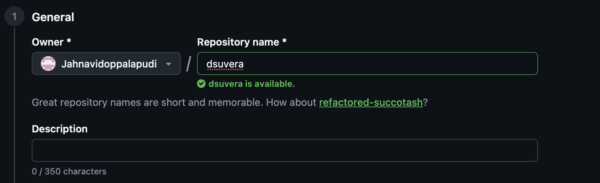

# Real-Time Public Safety Alerts


> A streaming pipeline for live U.S. government hazard data: National Weather Service alerts
> and USGS earthquakes. Alerts are updated and cancelled after they are issued, earthquakes are
> revised as more data arrives, and both arrive by polling. The pipeline turns that into a clean,
> ordered, deduplicated event stream.

**Status:** ✅ Live end to end: two government feeds → Kafka → stream processor → PostgreSQL →
Grafana, with incident tracking, Census population impact, and pipeline-health monitoring.

## The Problem

Public safety data is not a simple append-only feed:

- A **tornado warning** is followed by updates (area narrowed, time extended) and a
  cancellation. Each is a new message that references earlier ones.
- An **earthquake** is first published automatically, then revised (magnitude 4.6 → 4.8,
  location refined, reviewed by a seismologist) under the same event id.
- Both feeds are **polled**: every minute returns everything still active, so most of each
  response has already been seen.

Downstream consumers need each change exactly once, in order per incident, with bad records
isolated instead of breaking the stream.

## Architecture

```
api.weather.gov (NWS alerts) ──┐   conditional GET          ┌─▶ gov.nws.alerts.v1        (key: incident)
                               ├─▶ Python producer ─────────┼─▶ gov.usgs.earthquakes.v1  (key: event id)
USGS earthquake feed ──────────┘   validate · dedupe · Avro └─▶ gov.ingest.dlq.v1        (rejected + reason)
                                           │                            │
                                    Schema Registry               Redpanda (Kafka API)
                                                                        │
                       Census API (county population) ──▶ stream processor (consumer group)
                                                          │  one DB transaction per batch,
                                                          │  then commit offsets
                                                          ▼
                                     PostgreSQL: messages · incidents · quake versions · lag
                                                          │
                                                          ▼
                                     Grafana: live hazards, people affected, pipeline health
```

## Tech Stack

| Layer | Tool |
|---|---|
| Event log | Redpanda (Kafka API) with built-in Schema Registry |
| Serialization | Avro schemas, registered per topic |
| Producer | Python, confluent-kafka (librdkafka), idempotent producer |
| Sources | NWS alerts API (CAP), USGS real-time earthquake GeoJSON feed |
| Processing | Python consumer group, manual offset commits, idempotent upserts |
| State & serving | PostgreSQL 16 (state, views), Grafana 13 (provisioned dashboards) |
| Enrichment | Census Bureau ACS 5-year county population |
| Testing | pytest: mock Kafka broker, real PostgreSQL (CI service), crash-and-replay, every dashboard query |

## Ingestion: How It Works

Every 60 seconds the producer polls both feeds and, for each record:

1. **Validates and normalizes** it: UTC timestamps, county FIPS codes derived from NWS SAME codes
   (for joining with Census population), references to earlier alerts.
2. **Skips versions already published.** Each message carries a `version_key` header.
3. **Serializes with Avro** against the registered schema.
4. **Publishes with a key** that keeps related messages ordered: an alert and all its updates
   share an *incident key*; earthquake revisions share the event id.
5. **Dead-letters** anything that breaks the contract, with the stage, error and original payload.

**Reliability choices**

- **Conditional requests:** the producer sends the previous `ETag` / `Last-Modified`, so an
  unchanged feed returns `304 Not Modified` instead of the full payload.
- **Idempotent producer** (`acks=all`): retries never duplicate messages in the log.
- **Confirmed before remembered:** a version is only marked published once the broker confirms
  it, so a failed send is retried on the next poll instead of being lost.
- **At-least-once with idempotent consumers:** after a restart, recent versions may be sent again;
  consumers deduplicate on `version_key` ([ADR-002](docs/adr/002-delivery-guarantees-and-keys.md)).
- **Isolation:** one feed being down never stops the other; one bad record never stops a feed.
- **24-hour USGS window:** a producer outage of up to a day loses no earthquake revisions.
- **Topics as code:** partitions and retention are defined in `src/topics.py` and created on start.

## Processing: How It Works

The processor consumes both topics and keeps live state in PostgreSQL:

- **Incidents:** each Alert, Update and Cancel is linked to its hazard through its references.
  The newest message decides the current area, severity and state, whatever order messages
  arrive in. A cancellation can never be undone by a delayed update ([ADR-005](docs/adr/005-incident-state.md)).
- **Earthquakes:** every revision is kept; the latest version and the first-published magnitude
  are tracked, so revisions (M4.6 → M4.8) are visible.
- **People affected:** alert counties are joined to Census county population. Each county is
  counted once when several warnings cover it.
- **Effectively-once results:** each batch is one database transaction; Kafka offsets are committed
  only after it succeeds. A crash replays the batch, and idempotent writes make the replay a no-op.
  This is tested by replaying the entire stream and checking that nothing changes.
- **Bad messages:** a per-message savepoint rolls back only the bad message, which goes to the dead
  letter queue. The partition keeps flowing.

## Live Dashboard



Grafana at http://localhost:3000, provisioned from code (`grafana/`):

| Section | Panels |
|---|---|
| Right now | Active warnings · people under a warning · earthquakes M2.5+ · data freshness |
| Alerts | New alerts by severity (event time) · people under warnings by state · top hazards by people affected |
| Earthquakes | Map of the last 24 hours · events revised after first publication |
| Pipeline health | Consumer lag · latency (source → ingest → stored) · processed vs duplicates vs errors |

Every panel query runs against a populated PostgreSQL in CI, so a broken query fails the build.

## Why No Airflow?

This pipeline is streaming: the producer polls every minute and the processor consumes Kafka
continuously. Neither ever "finishes," so they run as long-lived services that restart on failure.
An orchestrator is built for scheduled batch work (my SEC lakehouse project uses Airflow for exactly
that); running a never-ending consumer inside one fights its retries and timeouts.

## Key Design Decisions

- [ADR-001](docs/adr/001-redpanda-local-broker.md): Redpanda as a lightweight Kafka-compatible broker
- [ADR-002](docs/adr/002-delivery-guarantees-and-keys.md): at-least-once delivery, idempotent consumers, incident keys
- [ADR-003](docs/adr/003-avro-schemas.md): Avro schemas, event vs processing time, safe schema evolution
- [ADR-004](docs/adr/004-stream-processing-design.md): consumer + idempotent PostgreSQL sink, and why not Flink or Spark here
- [ADR-005](docs/adr/005-incident-state.md): modelling incidents from chains of alert messages

## How to Run

Requires Docker Desktop and Python 3.12.

```bash
git clone git@github.com:Jahnavidoppalapudi/realtime-public-safety-alerts.git
cd realtime-public-safety-alerts
make env          # creates .env; set CONTACT_USER_AGENT to your app name and email
make setup        # local dev tools
make test         # unit tests + Kafka tests against an in-process mock broker
make up           # start the whole stack
make logs         # producer: fetched, published, already seen, dead-lettered per cycle
make plogs        # processor: new messages, duplicates, errors per batch
make incidents    # active hazards affecting the most people
make dashboard    # open Grafana
make dlq          # rejected records and why
make test-db      # all tests, including database tests against the running PostgreSQL
```

- Grafana: http://localhost:3000 (no login needed to view)
- Redpanda Console: http://localhost:8085 (topics, messages, schemas, consumer lag)

## Project Structure

```
├── src/
│   ├── producer.py   # polling loop, graceful shutdown
│   ├── processor.py  # consumer: batch → transaction → offset commit, lag
│   ├── store.py      # idempotent, order-independent writes; incident resolution
│   ├── census.py     # county population enrichment
│   ├── pipeline.py   # validate → dedupe → serialize → publish → DLQ
│   ├── nws.py        # NWS alert parsing, incident keys, SAME → FIPS
│   ├── usgs.py       # USGS event parsing and versioning
│   ├── feeds.py      # conditional HTTP polling with retries
│   ├── topics.py     # topic definitions
│   └── schemas/      # Avro schemas
├── sql/schema.sql    # tables and dashboard views (applied on start)
├── grafana/          # data source, dashboard provider, dashboard JSON
├── tests/            # parsers, Kafka (mock broker), PostgreSQL, replay, dashboard queries
└── docs/adr/         # architecture decision records
```

## What I'd Do in Production

- Three or more brokers with replication factor 3 and `min.insync.replicas=2`.
- Register schemas from CI with compatibility checks; disable auto-registration.
- Alert on producer cycle failures, dead-letter rate, and feed freshness (no new USGS version
  in N minutes usually means the feed or the producer is stuck).
- Persist producer state (ETags, seen versions) to survive restarts without re-sending.
- Run the producer with two replicas and leader election, or as a scheduled job with a lock.
- Grafana alert rules on freshness, lag and dead-letter rate, routed to on-call.
- Polygon-level population (PostGIS + block-level Census data) instead of whole counties.

## Data Sources

- National Weather Service, [api.weather.gov](https://www.weather.gov/documentation/services-web-api) (public domain). Requests identify the app and a contact email, as NWS requires.
- U.S. Geological Survey, real-time earthquake feeds (public domain).
- U.S. Census Bureau, American Community Survey 5-year estimates, table B01003 (public domain).

## Observations from Live Runs

### 1. Duplicate alerts inside a single NWS response
- **What happened:** The first poll fetched 463 active alerts but published 460. Three were
  skipped as "already seen" before anything had been published.
- **Cause:** The NWS active-alerts feed returned the same alert more than once in one response.
- **Why it mattered:** The in-flight check in `publish_batch` caught it. Without it, those alerts
  would have been written to Kafka twice.

### 2. Conditional requests saved nothing
- **What happened:** Across every cycle, neither feed answered `304 Not Modified`.
- **Likely cause:** Both feeds are regenerated every minute, so their ETag and Last-Modified
  change even when no alert or earthquake did.
- **Lesson:** I measured the optimization instead of assuming it worked. Deduplication on
  `version_key` is what actually prevents re-sending; conditional requests are kept because
  they are harmless and would help if a feed starts honoring them.
